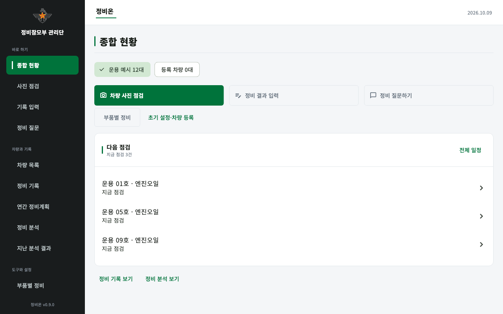

# 정비온

**기동장비 데이터 기반 AI 정비관리 · Flutter Android 태블릿 앱**

차량 현황부터 사진 점검, 정비·운행 기록, 다음 정비 일정까지 한곳에서 관리합니다. 기록과 사진은 기기 안에 보관하며, 로그인이나 운영 서버 없이 사용할 수 있습니다. 설치된 정비 책자를 검색하고 차량 이력에 연결하는 로컬 AI 정비 도우미도 제공합니다.



> 위 화면과 저장소의 예제 차량·기록은 합성 데이터입니다. 실제 군 장비 정보나 업무 자료를 포함하지 않습니다.

## 주요 기능

| 기능 | 제공 내용 |
| --- | --- |
| 종합 현황 | 관리 차량, 점검 필요 항목, 정비 건수·비용, 일정 달력과 월별 추이 |
| 차량 관리 | 차량 등록·상세 조회, 검색, 출고연도·AI 상태별 필터 |
| AI 상태 조회 | 낮음·관찰·높음·미분석을 구분하고 홈과 차량 목록의 조회 기준 통일 |
| 사진 점검 | 전면 외관·엔진룸 촬영, 사진 위 번호 마크 추가·삭제, 메모·녹음 저장 |
| 디지털 트윈 시연 | 부위별 순차 스캔, 상태 변화, 이상 의심 부위 강조와 확인 흐름 |
| 정비·운행 기록 | 두 기록 탭, 전체·이번 달·최근 3개월·직접 선택 기간 필터, 수정·삭제 |
| 정비 계획 | 확인된 교환 주기·최근 계기와 연결한 잔여 정비거리, 달력 일정 관리 |
| 정비 질문·책자 검색 | 차량 이력과 등록된 문서의 근거 검색, 인용 문장·원문 그림 확인 |

### 사진 점검의 두 가지 흐름

- **직접 촬영:** 차량 선택 → 전면 외관 또는 엔진룸 촬영 → 사진을 눌러 번호 마크 추가 → 메모 작성 → 사진·점검 기록 저장. 마크를 다시 누르거나 취소 버튼으로 삭제할 수 있습니다. 부위별 상태를 강제로 선택하지 않습니다.
- **AI 검사 시연:** 차량 이미지 선택 → AI 점검 시작 → 부위별 순차 검사 → 이상 의심 부위 확인 → 결과 저장 또는 직접 촬영으로 이동. 저장된 결과에는 시연 출처가 보존됩니다.

AI 검사 시연은 화면·업무 흐름을 재현하는 고정 시나리오입니다. 실제 사진을 분석해 고장을 판정하는 기능과 구분합니다. 군용 차량 느낌의 전면·엔진룸 이미지는 생성 이미지이며 실제 장비 사진이 아닙니다.

### 기록 데이터

정비 기록은 정비일자·차량번호·계통·부품명·작업 내용·비용을 중심으로 정리합니다. 운행 기록은 차량번호·차종·출고연도·누적 거리·누적 시간·누적 유류를 표시합니다. 누적 계기값을 선택 기간의 실제 사용량으로 바꾸어 표시하지 않습니다.

기본 메뉴는 **홈 · 사진 점검 · 기록 · 정비 질문 · 더 보기**입니다. 백업·자료 가져오기와 현장 요청은 일반 메뉴에서 제외했으며, 기존 로컬 저장·백업 관련 코드와 데이터 호환성은 유지합니다.

## 기술 구성

| 영역 | 기술 |
| --- | --- |
| 화면·상태·라우팅 | Flutter, Dart, Riverpod, go_router |
| 로컬 데이터 | Drift / SQLite, 앱 내부 사진·녹음 파일 |
| 카메라·기기 기능 | camera, Kotlin, Android 플랫폼 채널 |
| 선택형 모델 실행 | ONNX Runtime, 별도 모델 실행 프로세스 |
| 문서 검색·요약 | 로컬 키워드·임베딩 혼합 검색, 선택형 llama.cpp 요약 |
| 개발·검증 | Flutter 위젯·골든 테스트, Python 평가 도구, Android 기기 점검 도구 |

```text
lib/
  data/       차량·기록·일정·사진 마크·로컬 검색·모델 실행
  ui/         홈·차량·점검·기록·질문·공통 화면
android/      카메라·녹음·파일 선택·모델 실행 연결
assets/
  branding/   로고·캐릭터·생성 차량 이미지
  mock/       합성 예제 데이터
  models/     공개용 합성 모델·설정
  fonts/      한국어 글꼴과 라이선스
test/         단위·위젯·업무 흐름·화면 비교 테스트
tools/        모델 준비·합성 데이터·평가·기기 검증 도구
docs/         구조·데이터·검증·실행 안내
```

## 시작하기

### 개발 환경

- Dart `^3.13.0`을 지원하는 Flutter stable
- Android SDK와 Android 빌드용 JDK
- Android API 24 이상 기기. 선택 LLM 기능은 추가 조건이 있습니다.

현재 작업 환경에서는 Flutter 3.47.7 / Dart 3.13.5 / JDK 21로 ARM64 release APK를 빌드했습니다. Android Java·Kotlin 컴파일 타깃은 17입니다. 실기기 최소 RAM과 모든 기기 조합의 동작을 확정한 것은 아닙니다.

### 설치와 실행

```sh
git clone https://github.com/Superkid0714/2026-military-mobile.git
cd 2026-military-mobile
flutter doctor -v
flutter pub get
```

Android 빌드 전에 개발 PC에서 ONNX Runtime AAR을 준비합니다. 아래 스크립트는 고정 버전의 파일을 내려받아 SHA-256을 검증합니다. PowerShell이 필요합니다.

```sh
pwsh -File tools/provision_onnx_android.ps1
flutter devices
flutter run -d <기기ID>
```

ARM64 태블릿용 APK 빌드:

```sh
flutter build apk --release --target-platform android-arm64
```

산출물은 `build/app/outputs/flutter-apk/app-release.apk`입니다. 현재 release 설정은 개발용 서명을 사용하므로 정식 배포 시 별도 서명 구성이 필요합니다. SDK·로컬 캐시 구성은 [개발 환경 안내](docs/00-workspace-setup.md)를 참고하세요.

### 선택 모델과 문서 자료

기본 기록 관리와 사진 마크 기능에는 별도 AI 가중치가 필요하지 않습니다. 임베딩 검색·선택 LLM·실제 Vision 모델은 가중치, 네이티브 라이브러리와 검색 자료를 개발 PC에서 별도로 준비해야 합니다. 앱이 실행 중 모델을 자동으로 내려받거나 재학습하지 않습니다.

- [전체 책자 검색 구성](docs/14-manual-rag.md)
- [로컬 정비 도우미](docs/16-offline-assistant.md)
- [원문 그림·페이지 이미지](docs/18-offline-manual-images.md)
- [카메라 분석 적용 범위](docs/41-camera-analysis-scope.md)

## 테스트와 검증

```sh
flutter analyze
flutter test
```

화면 비교 테스트는 운영체제·글꼴 렌더링 환경별 기준 이미지를 사용합니다. 기준 이미지는 화면 변경을 확인한 뒤 갱신합니다. 자세한 방식은 [골든 테스트 안내](test/goldens/README.md)를 참고하세요.

현재 변경 사항의 재검증 결과와 실행하지 못한 검사는 [2026-11-13 변경·검증 기록](docs/43-ui-and-inspection-2026-11-13.md)에 구분해 기록합니다. 과거 문서의 검증 수치를 현재 실행 결과로 해석하지 않습니다.

## AI와 공개 데이터의 범위

- 저장소의 예측 모델과 성능 수치는 **합성 데이터 기준**입니다. 실제 차량의 고장 확률이나 정비 판단 정확도를 입증하지 않습니다.
- 디지털 트윈의 부위별 검사 연출과 선택형 실제 모델 추론은 별개의 실행 경로입니다.
- 문서 검색 결과는 등록한 자료에 의존합니다. 원문과 정비 기준은 사용자가 확인합니다.
- 원본 업무 자료, 실제 식별자·사진, 원자료에서 만든 모델·색인, 인증정보, APK·로컬 DB는 공개하지 않습니다.
- `private/`, `output/`, `.tools/`, `models/local/` 및 민감 파일 형식은 `.gitignore`로 제외합니다.

## 문서

| 문서 | 내용 |
| --- | --- |
| [개발 환경](docs/00-workspace-setup.md) | 저장소 연결, 빌드 준비와 실행 |
| [앱 구조](docs/02-app-and-architecture.md) | 화면·저장·예측 갱신 구조 |
| [합성 데이터](docs/03-synthetic-data.md) | 예제 데이터 구성과 생성 규칙 |
| [모델 평가](docs/04-model-evaluation.md) | 합성 모델 평가와 해석 범위 |
| [로컬 데이터 관리](docs/06-local-data-management.md) | 수정·삭제·백업·복원 구조 |
| [최신 변경·검증](docs/43-ui-and-inspection-2026-11-13.md) | 현재 화면 흐름과 재검증 결과 |

개발: **[Lucel · Superkid0714](https://github.com/Superkid0714)**
